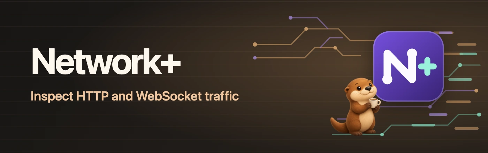
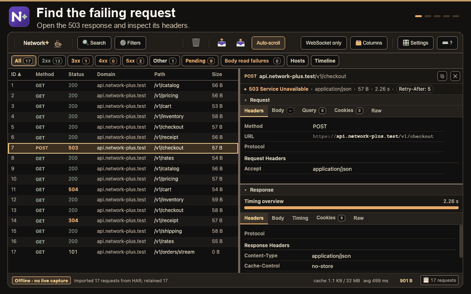

# 

**Chrome・EdgeのDevToolsで、調べたい通信をすばやく見つける。**

[English](README.md) · **日本語**

**今すぐ試す:** [最新リリースのZIP](https://github.com/himiyosh/network-plus-extension/releases/latest) · [Chrome Web Store](https://chromewebstore.google.com/detail/mhidipnhdnonbjkfklcohmnnmfggjlpo) · [Edge Add-ons](https://microsoftedge.microsoft.com/addons/detail/network-for-devtools/dhmafmhaagefmichhmmkknapalhmlmal)

## 操作デモ

デモは合成HARを使用しています。サンプルはネットワーク通信を送信しません。

- **対象の通信を探して比較。** 記録全体の参照可能なヘッダーや本文を検索し、フィルターで一覧から隠れた結果も開けます。2件を選んで横並びで比較できます。
- **遅い通信やWebSocketの中身を確認。** タイムラインから時間帯を絞り、WebSocketの送受信を時系列で追ってJSONを展開できます。
- **記録を開いて共有。** ツールバーからHAR・SAZを読み込めます。コピーとエクスポートは機密項目を伏せた形式が既定です。

## はじめかた

1. お使いのブラウザーのストアからインストールし、拡張機能メニューかツールバーから **Network+** を開きます。
2. 保存済みの記録は **HAR・SAZを開く** を選びます。ライブ通信は **ライブ記録を始める** を選び、案内に沿ってDevToolsの **Network+** タブを開きます。
3. ライブ記録では、同じタブで記録したいサイトに移動します。パネルが空の状態では、組み込みサンプルでも操作を試せます。

ZIPやソースから読み込む

### リリース ZIP からインストール

1. [最新リリースのZIP](https://github.com/himiyosh/network-plus-extension/releases/latest)をダウンロードします。
2. ZIPを展開し、`chrome://extensions/` または `edge://extensions/` で **デベロッパー モード** を有効にします。
3. **展開して読み込み** を選び、`manifest.json` があるフォルダーを指定します。DevToolsの **Network+** タブを開きます。

展開して読み込んだ版は手動で更新してください。ソースを試す場合は、同じ手順でリポジトリのルートを指定します。

## プライバシーと不具合報告

記録した通信は端末内で処理します。コピーとエクスポートはサニタイズ済みが既定です。完全版を含め、共有前に内容を確認してください。 [プライバシー通知](docs/privacy.md)

不具合はツールバーの **不具合を報告** または [報告フォーム](https://docs.google.com/forms/d/e/1FAIpQLScPzbNqgDnYQEjHr0yFsBA9ANAoB_n1SlTUe1AYEhTC_iJk3w/viewform) から報告できます。ツールバーから開くと、バージョンなど任意の環境情報が入ります。公開の [GitHub Issue](https://github.com/himiyosh/network-plus-extension/issues/new/choose) に貼る場合は、キーボードショートカット画面の **安全なサポート情報をコピー** を使い、内容を確認してください。実通信や認証情報は投稿に含めないでください。

## プロジェクト情報

[変更履歴](docs/CHANGELOG.md) · [アーキテクチャ](docs/architecture.md) · [手動テスト項目](docs/manual-test-checklist.md) · [開発ガイド](.github/copilot-instructions.md) · [MITライセンス](LICENSE)

開発にはNode.js 22または24を使います。チェックアウトしたフォルダーで `npm ci`、`npm test`、`npm run lint` を実行してください。 [CIの検証項目](.github/workflows/quality-gates.yml)

Network+の全機能を無料で使えます。 [GitHub Sponsors](https://github.com/sponsors/himiyosh) · [Gumroad Coffee](https://himiyosh.gumroad.com/coffee)
