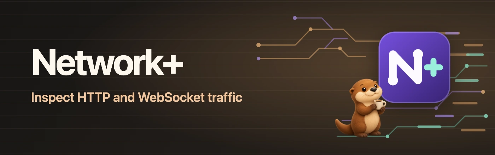
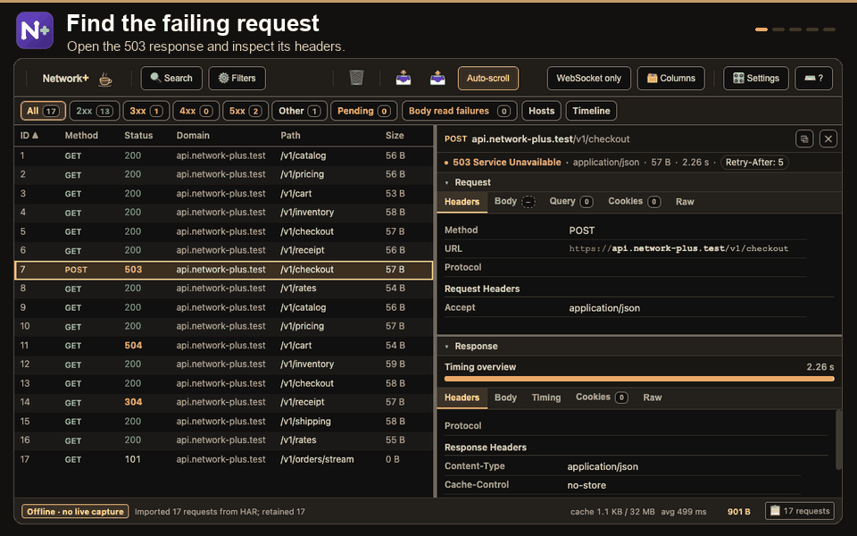

# 

**Find the request that matters in Chrome and Edge DevTools.**

**English** · [日本語](README.ja.md)

**Try it now:** [Latest release ZIP](https://github.com/Studio344/network-plus-extension/releases/latest) · [Chrome Web Store](https://chromewebstore.google.com/detail/mhidipnhdnonbjkfklcohmnnmfggjlpo) · [Edge Add-ons](https://microsoftedge.microsoft.com/addons/detail/network-for-devtools/dhmafmhaagefmichhmmkknapalhmlmal)

## See Network+ in action

The demo uses a synthetic HAR file. The sample does not send network traffic.

- **Find and compare requests.** Search available headers and bodies across the capture, open matches outside the current list filter, or compare two requests side by side.
- **See when traffic slows.** Narrow the request list with the timeline and follow WebSocket messages in either direction with expandable JSON.
- **Inspect and share captures.** Open HAR or SAZ files from the toolbar. Copy and export with sensitive fields redacted by default.

## Quick start

1. Install from the store for your browser and open **Network+** from the extensions menu or toolbar.
2. Choose **Open HAR or SAZ** for a saved capture. For live traffic, choose **Start live recording**, follow the shortcut in the guide, and select **Network+** in DevTools.
3. For live recording, open the site you want to record in the same tab. To try the panel with local sample data, choose **Explore sample capture** when the list is empty.

Install an unpacked build

### Install from the release ZIP

1. Download the [latest release ZIP](https://github.com/Studio344/network-plus-extension/releases/latest).
2. Extract it into a new folder. Open `chrome://extensions/` or `edge://extensions/` and turn on **Developer mode**.
3. Choose **Load unpacked** and select the folder containing `manifest.json`. Open DevTools and select **Network+**.

An unpacked install must be updated manually. To try the source, follow the same steps using the repository root.

## Privacy and support

Captures are processed locally. Sanitized output is the default for copy and export. Review the result before sharing, especially when using full export. [Privacy notice](docs/privacy.md)

Use **Report a problem** in the toolbar menu or open the [report form](https://docs.google.com/forms/d/e/1FAIpQLScPzbNqgDnYQEjHr0yFsBA9ANAoB_n1SlTUe1AYEhTC_iJk3w/viewform). The toolbar pre-fills optional version and environment details. For a public [GitHub issue](https://github.com/Studio344/network-plus-extension/issues/new/choose), use **Copy safe support summary** from Keyboard Shortcuts and review the copied text before posting. Leave out real traffic and credentials.

## Project links

[Changelog](docs/CHANGELOG.md) · [Architecture](docs/architecture.md) · [Manual test checklist](docs/manual-test-checklist.md) · [Contributor guide](.github/copilot-instructions.md) · [MIT license](LICENSE)

Use Node.js 22 or 24 for development. Run `npm ci`, `npm test`, and `npm run lint` from a checkout. The [quality gates](.github/workflows/quality-gates.yml) list the full PR checks and run the browser suites.

Network+ is free to use. [GitHub Sponsors](https://github.com/sponsors/himiyosh) · [Gumroad Coffee](https://himiyosh.gumroad.com/coffee)
